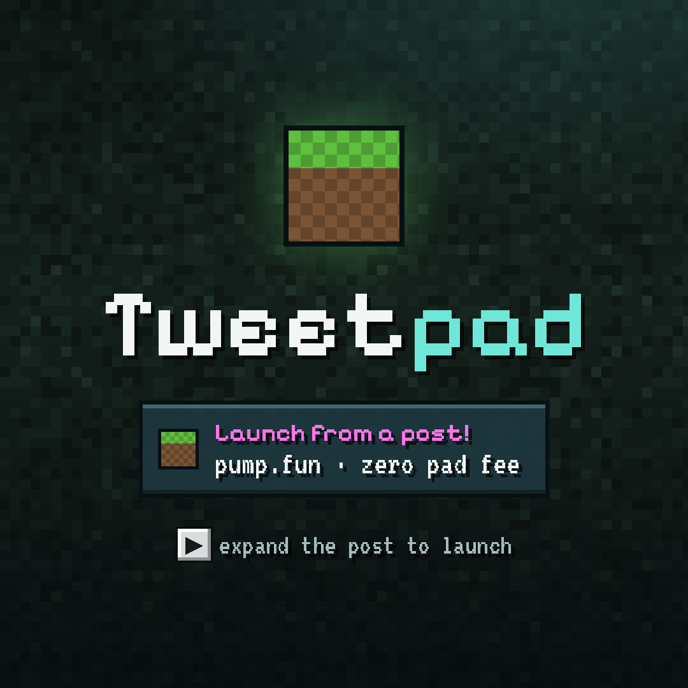

<p align="center">
  <picture>
    <source media="(prefers-color-scheme: dark)" srcset="docs/brand/lockup-dark.png">
    
  </picture>
</p>

<p align="center"><b>Launch a token without leaving the tweet.</b></p>

<p align="center"><a href="https://www.tweetpad.io">tweetpad.io</a> · <a href="https://x.com/tweetpad_io">@tweetpad_io</a> · <a href="https://github.com/cloutprotocol/tweetpad">github.com/cloutprotocol/tweetpad</a></p>

tweetpad is an X player card dressed as the 2012 bird app (or a pixel HUD, if you pick that skin). Expand the tweet, connect a Solana wallet, drop an image, pick a ticker,
press **Launch**. The coin goes live on pump.fun, gets listed on tweetpad, and has its own chart, live trades and a
shareable card that plays inside X again. No app to install and no tab to open.

> Launches are plain SOL pairs for now. Once the platform token exists, setting `QUOTE_MINT` pairs every new coin
> with it, so every trade on a tweetpad coin buys the platform token first. Coins already paired with `$JACK` (the
> earlier stand-in) keep their pair, and their creators can still claim `$JACK` fees.



## What it does

| | |
| --- | --- |
| **Launch** | Opens on Solana (pump.fun) every visit. Image (pick, drop or paste), name, ticker, a description of up to 140 characters, optional X / Telegram / website links, and a dev buy with a live estimate of the tokens it gets. One wallet approval. Live on pump.fun in seconds. |
| **Jito bundle** | "⚡ Bundle with Jito" (on by default, Solana): the launch, create and dev buy together, carries a 0.0001 SOL tip and goes to Jito's block engine, so it lands first in its block and never sits in the public mempool. One wallet, one signature; the tip is the user's (`api/_jito.js`). |
| **EVM chains** | A Solana / Robinhood / BNB / Base switch on the launch form. EVM launches go through Launch Party's live solo launcher on each chain (the same factory contract, its own gateway and hook per chain, `api/_evm.js` `NETS`) with a 1% trading fee, split between the creator and holders as the creator chooses (Launch Party's hook keeps 10% of it): an EVM wallet (MetaMask, Rabby, Phantom…) signs one transaction that creates the token, opens its Uniswap v4 pool and makes the optional dev buy. Built and dry-run server side (`api/evm-create.js`), verified on chain before listing. |
| **Ethereum** | The fifth switch on the launch form: Ethereum mainnet through [Launch Party](https://party.studio)'s CustomLaunch (`api/_eth-launch.js`). The browser asks Launch Party's public review (`custom/prepare`, its `claus` template) for the coin; it packs a fixed-supply token and a fixed FeeHookV1, reviews them and signs a 30-minute approval. tweetpad checks the answer byte for byte (the template's exact creation code plus exactly the arguments asked for: name, ticker, metadata, fee, the creator as fee recipient, no team share, no upgradeable hook), rebuilds `launchSolo` itself, estimates gas from the creator's wallet, and lists the coin only when its terms on chain hash to the ones approved here (`api/_eth-coins.js`). The creator picks the fee (0–5% of every trade, paid in ETH and in the coin) and the starting market cap (2–25 ETH). Costs 0.001 ETH plus about 2.3M gas; the 0.001 ETH sell-check buy comes back in the same transaction. Trades through Uniswap v4 on Ethereum's Universal Router (no `sqrtPriceLimitX96` there), fees claimed with the hook's permissionless `collect`. |
| **Custom launch** | `/custom`: the Ethereum launch with every option, on its own page (its own X player card `?embed`, which opens the deployer in place, `?popup` for the deployer alone, which More → Custom launch opens in the card's own frame, and card image). The fee hook **fixed** (two contracts) or **upgradeable** (Launch Party's ManagedHookProxy in front of the hook's logic, the creator its admin: they can point it at new logic in public, or freeze it for good, which the page offers for each of their upgradeable hooks), a team share (5–20%, vesting 30–120 days to the creator), the fee and the starting value. Checked as strictly as the launch form's: the proxy's admin must be the creator and its implementation the logic deployed beside it. An upgradeable coin's page says so. **Agents**: `skills/tweetpad-custom-launch/SKILL.md` (served at `/skills/…`) walks an AI agent through the same API, so a coin an agent prepares is checked and listed here; the person always signs. |
| **Pairing** | "Pair with" on the form: SOL (default) or any coin launched on tweetpad, picked from a grid you can search by name, ticker or contract. The server checks pump.fun accepts it before building (`create_v2`). `QUOTE_MINT` sets the default pair. |
| **Stonkfun** | On Solana the pair picks the launchpad: "Pair with" shows every pair at once, filtered by All · pump.fun · Stonkfun, with pump.fun's (SOL, the default, or a tweetpad coin) above [Stonkfun](https://www.stonkfun.xyz)'s (SOL, the tokenized stocks TSLAx, NVDAx, SPYx…, and USDC; `api/stonk.js`). The pair chip names the launchpad. A Stonkfun pair brings its fee setup onto the form: **Creator fees** (no transfer tax; the creator's share of the 1% curve fee is forwarded by Stonkfun), **Holder rewards** (a 1% or 3% Token-2022 transfer tax that Stonkfun collects and pays to holders in the pair) or **Community** (the same, with a third of each payout to holders of the pair stock; stocks only). tweetpad builds Raydium LaunchLab's `initialize_with_token2022` under that setup's Stonkfun platform, every number from Stonkfun's `/launchlab/pricing` and every account derived here and checked against it (compared byte for byte with Stonkfun's own launches of each setup). Listed only after the transaction is re-read on chain (LaunchLab, the platform, the pool built here, the metadata) and the mint's transfer tax is read back: the rate built here and Stonkfun's withdraw authority, or no tax at all. The coin page shows the setup and, for a reward coin, what its holders have been paid (Stonkfun's v2 reads, through `/api/stonk?rewards=`). About 0.009 SOL; no dev buy or Jito yet. Prices come from GeckoTerminal (DexScreener doesn't list LaunchLab curves); trades go through Jupiter Ultra (0.1%), since Jupiter's regular API only routes the buy side of a stock-paired curve. Kept out of Claim and Auto-claim: there is nothing to claim. |
| **Bordrless** | The third chip on Solana's launchpad switch: [Bordrless](https://bordrless.app), a token standard of its own on Solana (not SPL, not Token-2022), whose tokens run their rules inside every trade (`api/bordrless.js`, `@bordrless/sdk` 0.10.0; 0.11.0 is published broken on npm). The form picks a creator fee (0.5%, 1% or 2% of each trade, to the creator in SOL) and Bordrless's rule presets: **Plain**, **Diamond hands** (early-buyer lock, max wallet 1%, creator lock 90 d, holder rewards 1%), **Burn** (0.5% burned each side, holder rewards 0.5%) or **Paid to hold** (holder rewards 2% on sells, creator lock 30 d). tweetpad builds `create_launch` on Bordrless's launchpad from its config as the chain holds it (treasury, curve, bounds), opening at the cap Bordrless's own site would give it, on Bordrless's lookup table, dry-run on mainnet before the wallet sees it. The dev buy is its own transaction (with the create it passes Solana's size limit), approved in the same wallet prompt and sent once the launch lands; the creator's first buy pays the normal LP fee inside the 30 s sniper window. Listed only after the transaction is re-read and the launch account holds the creator, fee and rules built here. Bordrless holdings aren't SPL accounts, so wallets don't list them and Jupiter doesn't route them: every Bordrless coin opens on its own trading page, `/b/<mint>` ("Bordrless pages" below), which reads balances, quotes and builds every buy and sell through `/api/bordrless` (SOL wrapped into bridged SOL inside the trade, a sell's SOL unwrapped back out), shows its rules and curve, and lets the creator claim creator fees and holders claim holder rewards, in SOL. About 0.035 SOL to launch (Bordrless's 0.01 SOL fee and rent); tweetpad takes nothing. |
| **Bordrless pages** | Every Bordrless token, launched here or not, has its own trading page at `/b/<mint>` (`api/b.js`, `assets/b.js`, `b.css`, in Bordrless's look): the coin and its market cap, an eight-hour chart, a buy and sell box (Wallet Standard; built and dry-run by `/api/bordrless`, signed by the wallet, sent from the page), what the connected wallet can claim (creator fees, holder rewards), the rules on every trade with what they have paid so far, the curve, who can change it, the last trades, and a share row. Everything on it is read with the SDK from the chain (`/api/bordrless?token=`: the mint and its authorities, the hook and its risk label, the launch and its rules, the pool's own price, the curve, the fees taken) plus the coin's metadata; only candles, trades, holder counts and 24h numbers come from Bordrless's indexer. The link plays as its own X player card (`/b/<mint>?embed`) with its own card image (`/b/<mint>/card.png`, 1080×1080: the coin, market cap, 24h, holders, the curve and its rules), so a posted link is the coin, tradeable in the post. The Tokens page's Bordrless rows, the app's Bordrless coins and their share links all open it; an old `/c/<mint>` link to a Bordrless coin plays it too. |
| **Any token** | Every token on the chains tweetpad runs on, launched here or not, has its own trading page at `/<chain>/<address>` (`sol`, `rh`, `bnb`, `base`, `eth`; `api/t.js`, `assets/t.js`, `t.css`, in the 2012 skin); `/t/<address>` finds the chain (a Solana address is Solana's; an EVM address goes where its most liquid pair is, from DexScreener). The page: the token with its chain's badge, its market cap and 24h move, a chart of its most liquid pool (GeckoTerminal, through `/api/chart`), a buy and sell box, its market (price, liquidity, 24h volume and trades, holders, the pool), what can be checked about it (on Solana Jupiter's audit: verified, mint and freeze authority, top holders, organic trading, and a link to the scanner; on EVM the explorer and a honeypot check), its last trades and a share row. Its numbers come from `/api/token` (DexScreener's most liquid pair, Jupiter's token list first on Solana, decimals read from the chain; kept 15s). Solana tokens are bought and sold through Jupiter straight from the page (balances from Jupiter's, since public RPCs now refuse `getTokenAccountsByOwner`); EVM tokens through KyberSwap's aggregator, the route built by `/api/token`, checked to go to KyberSwap's router (MetaAggregationRouterV2) for exactly the amount asked, and dry-run from the wallet (a sell asks for an exact approval first). The link plays as its own X player card (`?embed`) with its own card image (`/<chain>/<address>/card.png`, 1080×1080: the token, its chain as a pill on the app's blue bar and a badge on its picture, market cap, liquidity, holders). A coin launched here opens its own coin card instead, a Bordrless token its `/b/<mint>`; a `/c/<address>` link to any other token goes to its page, and so does a contract address pasted on the Tokens page. tweetpad takes nothing. |
| **Bordrless section** | `/borderless` (also `/bordrless`; its own X card, `?embed`, and card image `assets/bordrless-card.png`), the home page's Bordrless channel (Bordrless's ringed-sphere mark, `assets/menu/bordrless.png`), in Bordrless's look (`bordrless/index.html`, `assets/bhub.js`, `bhub.css`, sharing `assets/bkit.js` with `/b/<mint>`). **Tokens**: every Bordrless token by market cap, searchable, each opening its tradeable `/b/<mint>`. **Launch**: the Bordrless launcher on its own (image, name, ticker, description, creator fee, rule preset, dev buy with an estimate from the fresh curve), the same build as the app's form: IPFS, `?action=launch` dry-run on mainnet, one wallet prompt for the launch and the dev buy, the new mint signing the launch, listed after the chain is re-read. **Hooks** (`/api/bordrless?hooks=1`): the rules kit's presets ("Launch with it" opens the launcher on it), and the Workshop's approved hooks with Bordrless's readings, each re-read on chain with the SDK (`hookRiskLabel` for who can change the program, `decodeLaunchConfigAccount` for its config's creator fee and author share); launching with a Workshop hook stays on bordrless.app. |
| **Feed** | A pad-wide timeline: "What's happening?" in 140 characters, with one tweetpad coin embedded as a card; $TICKERs link to their coins. Likes, retweets (they land on the retweeter's profile) and replies, with a 2012-style tweet view. |
| **Tokens** | Every coin launched here, on every chain in one list, each coin image badged with its chain. Market cap, 1h move and the last day drawn faintly behind each row. New / Hot / Mcap, All / Solana / Robinhood / BNB / Base, 24 at a time. **Bordrless** (set apart at the right of the chain filter) swaps in every Bordrless token, launched here or not, from Bordrless's own list (`/api/bordrless?list`, kept 15s), stacked by market cap with its rank, holders and 24h move; New and Hot re-sort it. Any of them opens on the coin page and trades in the card, and its `/c/<mint>` link plays as its own card on X. |
| **Trade** | Buy and sell on the coin screen: presets, % of your bag, slippage, a live quote. Solana coins trade on their pump.fun curve through pump.fun's own SDK (`api/trade.js`, Jito optional), graduated ones through Jupiter's free API; Robinhood, BNB and Base coins in their Uniswap v4 pool through Uniswap's Universal Router on that chain (`api/evm-trade.js`). The wallet signs and pays; tweetpad takes no fee. |
| **Coin screen** | Candle chart, compact recent trades, live trades over a websocket, the creator (2012-style author card), copyable contract address, share card, and **posts**: tweet-sized comments (140 characters) signed in with the wallet. |
| **Inventory** | The hotbar holds your coins, then the newest. `1`–`9` opens them. |
| **More** | Profile, Games, Scanner, Winamp, Debug, About (version, network, $TP contract, contact) and Settings (skins) in one list. |
| **Profile** | Link your wallet to your X account with one tweet, see the coins you launched, claim creator rewards. Claim also sweeps the fees pump.fun leaves on each coin's curve and pool (v3 curve trades, v2 pool trades) until someone sweeps them, so the amount shown is everything the creator has. |
| **Auto-claim** | `/autoclaim`: turn it on in Profile with one free signature, and tweetpad's keeper (`api/keeper.js`, Vercel Cron every 5 minutes) claims the wallet's Solana creator fees to it once 0.005 SOL is waiting (`AUTOCLAIM_MIN_SOL`), paying the network fee itself. Only pump.fun's permissionless sweeps, `transfer_creator_fees_to_pump` and `collect_creator_fee`, so the fees can only go to the creator, and they arrive as SOL. Each claim is simulated before it is sent. Needs `KEEPER_SECRET` (a funded keeper wallet) and `CRON_SECRET`. The page has its own X player card (`?embed`) and card image. |
| **Settings** | Skins: **2012** (default: blue bar, white cards, dark tab bar), **Tweetcraft** (the pixel HUD), **Lights out** (pure black, hairlines, flat pills, like today's X, under tweetpad's own marks) or **Bordrless** (grey paper, black ink, condensed headlines, mono numbers, square cards on hard shadows). Saved per browser. |
| **Scanner** | `/scan` (its own X card; More → Scanner opens it in the card's frame): paste any Solana token. A Bordrless token gets its four authorities (mint, freeze, hook, metadata), the hook it runs and who can upgrade it (the SDK's `hookRiskLabel` and `mintRiskOf`), the rules its launch enforces on every trade, its market and curve, its top holders, and a **sell test**: a tenth of the biggest wallet's bag sold on its pool in a simulation, no signature needed. SPL and Token-2022 tokens get their mint and freeze authorities, transfer tax and transfer hook. A Bordrless coin page links to it. |
| **Agents** | Coming soon: a Grok-powered agent tied to a coin, watchable live in its card inside a post. The page shows a preview; the dev kit in `agents/` is real (spec, skill file template, manifest schema, an example, and a local runner on xAI's Responses API with your own key). |
| **Games** | `/games` (its own X card), tweetpad's games on [Gamba](https://gamba.so), Solana's on-chain casino protocol (`api/gamba.js`, `assets/gamba-kit.js`): **Pump or Dump** (`/games/pumpordump`: call the next candle at 2×, 3× or 5×, bets up to 0.1 SOL) and **Mines** (`/games/mines`: a 5×5 board with 3, 5 or 10 mines; each tile is its own Gamba play at the true odds of the tiles left, riding what the last tile won, and the server only lets a tile ride what the player's Game account shows the tile before it won; rounds start at up to 0.1 SOL and stop at 2 SOL; cashing out just stops). The house is Gamba's public SOL pool; Gamba's program holds each bet and its RNG settles it in about a second. Gamba commits to each seed (SHA-256) before the bet and reveals it when it settles; the page recomputes every result (HMAC-SHA256 of the seed, your seed and the play's number) and checks the hash. Plays are built server side from Gamba's IDL (compared byte for byte with `gamba-core-v2`), simulated, and decoded again in the browser before anything signs. **⚡ Instant play**: one free signature of a fixed message makes a game-balance key (its seed is the signature's SHA-256, so the same wallet makes the same key in any browser); the wallet tops it up (at most 1 SOL), it signs plays with no pop-ups, and Withdraw sends everything, the Gamba seat's rent included, back to that wallet only. Without it each play is a wallet approval. Every play names tweetpad's wallet as Gamba's creator (`GAMBA_CREATOR`; the plays show under it on Gamba's explorer): 1% of a Pump or Dump call, 0.5% of a Mines tile; without it the games are practice only. Practice (no money, the same odds and formula) is open everywhere; real plays need the 18+ box and are refused in the countries in `GAMBA_BLOCKED` (a default list when unset; `none` blocks nowhere; withdrawing is never refused). Fees on top of each play: tweetpad's, Gamba's 0.9% and the pool's 1.8% (read from chain), and 0.1% for the pool's jackpot on Pump or Dump. A player's first play takes Gamba's player seat first (about 0.0097 SOL, refunded on withdraw), so even that one has a committed seed. Each game has its own X player card (`?embed`) and card image, and the app's Games tab opens them in the card's frame (`?popup`). Five (BO1 zombies) opens on vel.gg. |
| **Winamp** | `/winamp`: [Webamp](https://github.com/captbaritone/webamp) (MIT) with the Sony 2000 SE skin, a playlist of tracker classics fetched from [The Mod Archive](https://modarchive.org) and rendered in the browser with libopenmpt, random skins from the [Winamp Skin Museum](https://skins.webamp.org), and Upload track for your own modules, MP3s and `.wsz` skins. A tweetpad-sized frame on the full page, the X player card (`?embed`), and the pop-out window (`?popup`) that More → Winamp and ⧉ Pop out open. |
| **Debug** | The original wallet-in-an-iframe probe: sign tests, environment, report, popup bridge. |

Keys: `C` wallet · `L` launch · `T` tokens · `F` feed · `M` more · `P` profile · `I` agents · `G` games · `J` Winamp · `A` about · `,` settings · `D` debug · `1`–`9` inventory · `H` chat · `Esc` back.

## How it works

```
X post ── player card (embed.html, sandboxed iframe) ──┬── wallet (Wallet Standard)
                                                       └── /api/* on Vercel ── Upstash Redis
                                                                  │
                         pump.fun IPFS · PumpPortal · pump SDK ───┤
                         DexScreener · GeckoTerminal · Solana RPC ┘
```

A launch, end to end:

1. **IPFS**: `/api/ipfs` checks the image bytes and pins image + metadata through pump.fun's IPFS endpoint
   (it answers servers, not browsers). Pinata is the fallback.
2. **Build**: the page makes a fresh mint keypair (it never leaves the page). `/api/create` builds the create
   transaction with pump.fun's SDK (paired) or PumpPortal (SOL), checks its signers and program, and records it as
   pending.
3. **Sign**: the wallet signs first (it may add instructions), then the mint signs the exact message the wallet returned.
4. **Send**: straight to Solana, then wait for confirmation.
5. **List**: `/api/launches` re-reads the transaction on chain (success, pump.fun program, payer, mint, pairing) before
   the coin goes on the list. A coin that was not built here cannot be listed.

### Things we learned the hard way

- **X's card iframe is sandboxed without `allow-forms`.** A `<form>` submit is dropped silently, with no `submit`
  event. Every action is a click handler.
- **Its origin can be opaque (`null`)**, so even our own API is cross-origin: every function answers CORS.
- **Wallets do reach the card on desktop**: Phantom and other Wallet Standard wallets register inside the frame.
  In the X mobile app there are no wallets, so the card offers "Open in Phantom / Solflare" instead.
- **ipfs.io rate-limits (429)**, so images go through `/api/image`, which races several gateways, resizes with sharp
  and caches forever (a CID never changes).
- **Solana v1 transactions exist now**: on-chain checks ask for `maxSupportedTransactionVersion: 1`.
- **Free reads only**: market data from DexScreener, candles and trades from GeckoTerminal, live trades from
  PumpPortal's websocket, X verification from the public tweet behind a link. No paid APIs.

### Profiles and X verification

Tweet a one-time code, paste the link, sign a message with the wallet. The server reads the public tweet
(X's syndication endpoint, no login or API key), checks the code and the date, and links `@handle` to the wallet.
Both halves are required, so nobody can claim someone else's wallet or handle.

## Layout

```
index.html             landing page, carries the X card tags
embed.html             the card app: markup only
preview.html           /preview: how each card looks in a post, from the live twitter:* tags
preview.png            the main X card image (source: scripts/preview.html)
site.webmanifest       app name and icons (wallet connect prompts, home screens)
assets/tweetpad.js     the card app (plain JS, no build step)
assets/tweetpad.css    layout and the Tweetcraft skin (pixel HUD)
assets/skin-2012.css   the default 2012 skin, layered over tweetpad.css
assets/skin-lights.css Lights out, the dark skin (built from the 2012 skin's selectors)
assets/skin-bordrless.css  Bordrless, the paper-and-ink skin (built from the 2012 skin's selectors)
agents/                the agents dev kit: README (spec), SKILL.template.md, agent.schema.json, examples/, run.mjs
assets/brand/          app icon kit: favicons, # icon sizes, # glyphs
api/                   Vercel functions, one per route; _lib.js (shared) and _evm.js (Robinhood Chain) are not routes
  ipfs · create · evm-create · launches · market · chart · image · upload     launching (Solana and Robinhood), the token list, prices and charts
  trade · evm-trade                                              buying and selling (Solana curve; Robinhood, BNB, Base v4 pools); _jito.js adds Jito tips
  card · card-image                                              share pages and their per-coin card images
  chat · social · reactions · profile · rewards                  chat, feed, posts, likes/retweets, profiles, creator fees
  gamba                                                          the games on Gamba: plays, the game balance, the plays list
  stonk · bordrless · b                                          Stonkfun launches; Bordrless launches, trades, claims, the scanner, and /b/<mint>
games/                 /games (index.html), /games/pumpordump and /games/mines; assets/gamba-kit.js (what they share), pumpordump.js,
                       mines.js, games.css
scan/                  /scan, the token scanner; assets/scan.js, scan.css (Bordrless's look)
assets/b.js, b.css     /b/<mint>, a Bordrless token's own trading page and X card (served by api/b.js)
scripts/check.js       `npm run check`: syntax and wiring smoke test
scripts/preview.html   source for preview.png (render command inside)
scripts/lockup.html    source for the README header lockup (docs/brand/lockup-*.png)
docs/CHECKLIST.md      what's next: critical fixes, quick wins, quality of life
docs/brand/            large brand files: 1024px icon, token profile pictures
```

## Run it

```sh
npm install
vercel link                      # once
vercel integration add upstash   # Redis; then `vercel env pull`
npm run local                    # http://localhost:3000/embed.html
npm run check
```

Settings live in [`.env.example`](.env.example): `QUOTE_MINT` (pairing token; empty means SOL), `RPC_URL`, `PINATA_JWT`, `GAMBA_CREATOR` and `GAMBA_BLOCKED` (Pump or Dump).

### Put it in a tweet

1. Deploy (`npm run deploy`) and point `index.html`'s `twitter:*` tags at your domain.
2. `embed.html` must not send `X-Frame-Options`; `vercel.json` sends `frame-ancestors` for X instead.
3. Post the domain. X caches cards per URL, so add `?v=2` after any change to the tags.
4. Share a single coin with `/c/<mint>`: its card opens straight to that coin.

## Safety notes

- Launches create real tokens on mainnet and cost real SOL. The card says so; the wallet shows the cost.
- The page never holds a user's keys. The only key it creates is the new coin's mint key, used once and discarded.
- Write endpoints are rate-limited per IP (Redis, fixed window).
- The games are real-money betting once `GAMBA_CREATOR` is set. Check where it may be offered before switching it on; `GAMBA_BLOCKED` is a starting list, not legal advice.
- Fresh `*.vercel.app` domains get phishing warnings in MetaMask. Use your own domain before going public.

## License

[MIT](LICENSE). Build your own pad, pair it with your own token, have fun.
